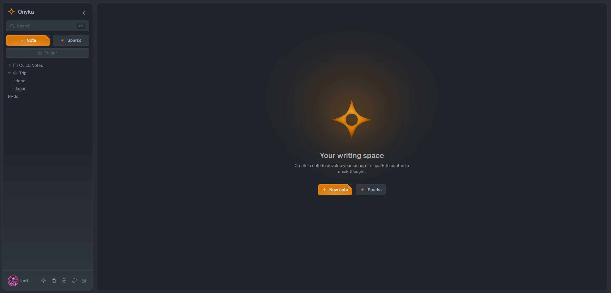

<div align="center">

<picture>
  <source media="(prefers-color-scheme: dark)" srcset=".github/assets/banner-dark.png">
  
</picture>

[Website](https://onyka.app) · [Install](#install) · [Configuration](#configuration) · [Backup](#backup-and-restore) · [Reverse proxy](#reverse-proxy)

</div>

> [!NOTE]
> Running Onyka without Docker now requires Node.js 24 or newer. Docker users have nothing to change.

## What is Onyka?

Note apps keep growing sideways, with databases, kanban boards, plugins and AI assistants. Onyka grows inward.

It is a self-hosted, open-source note app built entirely in TypeScript. You deploy it with Docker or install it with Node.js. Everything lives in one SQLite database, with no external service. Your content is encrypted at rest with AES-256-GCM, and there is no telemetry.

Fewer things. Done well.

## Features

- **Sparks.** A thought goes in with one keystroke, with no title and no folder. Each spark fades after 1 hour, 24 hours, 7 days or 30 days, or stays for good. You can pin up to five and turn the ones that matter into notes.
- **A rich editor.** It handles code blocks, tables, columns, images and a slash menu, with auto-save and Markdown paste. A note can hold several pages, and each page can be locked as read-only.
- **Real-time collaboration.** Several people edit the same note and see who is there. Notes carry threaded comments, and each share gives read, edit or admin rights.
- **Focus mode.** The sidebar hides and a timer runs from 1 to 180 minutes. A word count, daily streaks and a weekly recap follow your writing.
- **Organization.** Notes sit in folders you arrange by drag and drop. A tag filter can require tags or exclude them, and full-text search finds the rest. The trash keeps deleted notes for 30 days.
- **Your look.** Onyka comes with 10 themes, five dark and five light, plus 15 accent colors and 12 editor fonts. The app speaks English and French.
- **Security.** Onyka uses AES-256-GCM encryption at rest, Argon2id passwords, short-lived tokens with an HttpOnly refresh cookie, two-factor sign-in by email and rate limiting.
- **Admin console.** Admins manage users and see instance statistics and an audit log.
- **Installable.** Onyka installs from the browser on a phone or a computer, with no app store.

## Screenshot

<p align="center">
  
</p>

## Install

### Docker (recommended)

```bash
docker run -d --name onyka -p 3000:3000 -v onyka-data:/app/data ghcr.io/karl-cta/onyka:latest
```

Or with Docker Compose:

```bash
curl -O https://raw.githubusercontent.com/karl-cta/onyka/main/docker/docker-compose.yml
docker compose up -d
```

Open [http://localhost:3000](http://localhost:3000). That's it.

There is no `.env` file to write and no secret to generate. Everything is created on first launch, and the first user to register becomes admin.

### Node.js

Requires Node.js 24+ and pnpm 10+.

```bash
git clone https://github.com/karl-cta/onyka.git && cd onyka
pnpm install
pnpm build
pnpm start:prod  # http://localhost:3001
```

Secrets are generated on first start, so no `.env` is required. To change a setting such as SMTP or CORS, copy the example file and edit it:

```bash
cp apps/server/.env.example apps/server/.env
```

### Where your data lives

Everything is in one folder, `data/`:

```
data/
├── onyka.db          ← database (notes, users, settings)
├── uploads/          ← images, encrypted at rest like notes
├── .encryption-key   ← AES-256-GCM key, generated on first start
├── .jwt-secret       ← JWT signing key, generated on first start
└── backups/          ← backup archives
```

Back up this folder and you're safe. **Without `.encryption-key`, encrypted notes and images are lost for good.**

## Configuration

Onyka needs no configuration. These variables are optional, set in Docker Compose or in `.env`:

| Variable | Description | Default |
|----------|-------------|---------|
| `CORS_ORIGIN` | Allowed CORS origins, separated by commas | `http://localhost:5173` |
| `FRONTEND_URL` | Public URL, used in emails | `http://localhost:5173` |
| `TRUST_PROXY` | Set to `1` behind a reverse proxy | not set |
| `SMTP_HOST` | SMTP server for emails (2FA, password reset) | not set |
| `SMTP_PORT` | SMTP port | `587` |
| `SMTP_USER` | SMTP username | not set |
| `SMTP_PASS` | SMTP password | not set |
| `SMTP_FROM` | Email sender | `Onyka <noreply@onyka.app>` |

Without SMTP, the email features (2FA, password reset, email verification) turn themselves off.

`JWT_SECRET` and `ENCRYPTION_KEY`, when set, take priority over the generated files. See [`apps/server/.env.example`](apps/server/.env.example) for the other settings.

## Backup and restore

### Backup

```bash
# Node.js
pnpm db:backup
# → data/backups/onyka-2026-02-15_14-30-00.tar.gz

# Docker
docker exec onyka node scripts/backup.js
docker cp onyka:/app/data/backups/ .
```

The `.tar.gz` archive holds everything: database, uploads and encryption keys. One file to save.

### Restore

```bash
tar -xzf onyka-backup.tar.gz -C /path/to/data/
# Then restart Onyka
```

### Move to another server

```bash
# Old server
scp -r data/ user@new-server:/path/to/onyka/data/

# New server
docker compose up -d
```

One folder. That's it.

## Reverse proxy

Onyka listens on HTTP. In production, put it behind a reverse proxy for HTTPS, and set `TRUST_PROXY=1` so rate limiting sees the real client IP.

### Caddy (automatic HTTPS)

```
notes.example.com {
    reverse_proxy localhost:3000
}
```

### Nginx

```nginx
server {
    listen 443 ssl;
    server_name notes.example.com;

    ssl_certificate /etc/letsencrypt/live/notes.example.com/fullchain.pem;
    ssl_certificate_key /etc/letsencrypt/live/notes.example.com/privkey.pem;

    # Compression: strongly recommended, cuts the bundle size by about 70%
    gzip on;
    gzip_vary on;
    gzip_proxied any;
    gzip_comp_level 6;
    gzip_min_length 1000;
    gzip_types text/plain text/css application/json application/javascript
               text/xml application/xml application/xml+rss text/javascript
               image/svg+xml;

    # Static assets have hashed filenames, so they are safe to cache for long
    location ~* \.(js|css|png|jpg|jpeg|gif|ico|svg|woff|woff2|ttf|eot)$ {
        proxy_pass http://localhost:3000;
        proxy_set_header Host $host;
        expires 30d;
        add_header Cache-Control "public, immutable";
    }

    # API, pages and WebSocket
    location / {
        proxy_pass http://localhost:3000;
        proxy_http_version 1.1;
        proxy_set_header Upgrade $http_upgrade;
        proxy_set_header Connection "upgrade";
        proxy_set_header Host $host;
        proxy_set_header X-Real-IP $remote_addr;
        proxy_set_header X-Forwarded-For $proxy_add_x_forwarded_for;
        proxy_set_header X-Forwarded-Proto $scheme;
    }
}
```

> [!IMPORTANT]
> Without the `gzip` and caching directives, the browser downloads the full uncompressed bundle on every page load. The `Upgrade` and `Connection` headers are required for WebSocket, which real-time collaboration uses.

### Cloudflare Tunnel

```bash
cloudflared tunnel --url http://localhost:3000
```

## Development

```bash
pnpm dev          # Frontend (localhost:5173) and backend (localhost:3001)
pnpm build        # Build all packages
pnpm lint         # ESLint
pnpm typecheck    # TypeScript checks
pnpm test         # Run the tests
```

[CONTRIBUTING.md](CONTRIBUTING.md) describes the full workflow.

## Stack

The frontend uses React 19, Vite, TipTap, Zustand, Tailwind CSS and Socket.io. The backend uses Express, Drizzle ORM, better-sqlite3, Argon2, jose and Zod. Both live in a pnpm monorepo and ship as a multi-stage Alpine Docker image that runs as a non-root user.

## License

Onyka is licensed under the [GNU Affero General Public License v3.0](LICENSE). Self-hosting is free forever, with every feature.
